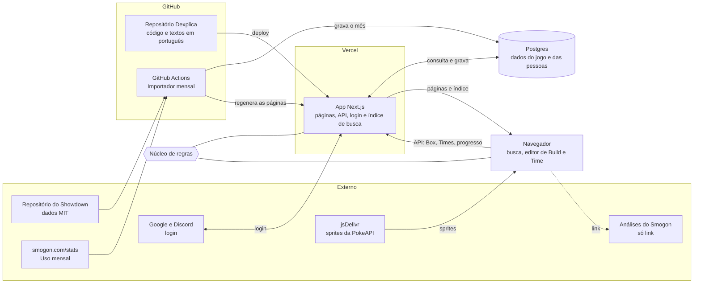

# Dexplica

> Seções 1 e 2 reescritas em 11/10/2026, depois da revisão do Projeto (ADR 0002). O desenho anterior, focado em Times, está guardado em `docs/teambuilder.md`.

Documento de definição do Projeto, preenchido antes da primeira linha de código. Preencha seção por seção, na ordem, com grilling: uma seção só fecha quando cumpre o critério "Fecha quando". Termos ficam no `CONTEXT.md`; decisões difíceis de reverter, em `docs/adr/`.

## 1. Problema e público

Qual dor, de quem, e como essa pessoa resolve isso hoje?

Fecha quando: existe uma frase "<Projeto> ajuda <público> a <resultado>" e o público está descrito (quem é, nível, onde está).

**Dexplica ajuda quem gosta de Pokémon e quer entender o competitivo a pesquisar qualquer Pokémon e entender, em português, tudo o que dá para fazer com ele e por quê.**

- **Quem:** quem gosta de Pokémon e quer saber mais do competitivo, incluindo quem não sabe nada (os amigos de Eduardo, para quem ele vai mandar o link).
- **Nível:** iniciante a intermediário. Conhece os tipos básicos, mas não sabe o que são IV, EV, natureza e habilidade, ou não sabe por que importam.
- **Onde está:** no Brasil, falando português. Joga nos jogos principais, no Showdown ou no Cobblemon.
- **Como resolve hoje:** abre um site para status e golpes (PokémonDB, Serebii), o Smogon para as Builds (em inglês, uma página por formato, muito texto) e uma calculadora à parte. Nada junta isso, e nada explica o porquê de cada escolha para quem está começando.
- **Usuário número 1:** Eduardo, que aprende cada Conceito antes de construir a página dele.
- **Fora do público por ora:** quem já domina o competitivo e procura análise de metagame; quem quer montar Times (versão seguinte).

## 2. Escopo da primeira versão

O que a primeira versão faz e, principalmente, o que fica de fora.

Fecha quando: a primeira versão cabe em 2 a 3 semanas de Sessões de construção e a lista "Fora" tem pelo menos 3 itens.

Cada versão tem um foco: **v1 o Pokémon → v2 o Time → v3 o Time com IA** (ADR 0002). Só dados livres (ADR 0003). O site é em português, e os nomes de Pokémon, golpes, habilidades, itens, tipos e naturezas ficam em inglês.

**Regra de escopo:** entra o que é do núcleo do Pokémon e está nos dados livres do Showdown. O que é específico de um jogo fica de fora.

- **Faz (v1)**, em 5 marcos, cada um no ar. Cada Conceito nasce no marco que precisa dele.
  - **M1, Pokémon:**
    - Busca por nome e as seções Pokémon e Tipos.
    - Seletor de Geração (7, 8 e 9). As listas têm a opção "Todas", que junta as Gerações do site e mostra em quais delas cada coisa existe. As páginas de detalhe abrem na Geração mais recente em que a coisa existe.
    - Página do Pokémon:
      - Status base e Perfil (Lado, Postura e Velocidade).
      - Formas (Mega, Gigantamax, regionais), linha de evolução e grupos de ovo.
      - Fraquezas, resistências, imunidades e contra quem ele é forte.
      - Habilidades e golpes separados por método (nível, TM, ovo, tutor).
      - Tier do Smogon na Geração, com uma Explicação.
    - Conceitos do marco: status base e tipos.
  - **M2, Enciclopédia:**
    - As seções Golpes, Habilidades, Itens e Formatos.
    - Descrições em português, traduzidas dos textos livres do Showdown e revisadas.
    - Os 583 itens do Showdown, em Grupos de itens:
      - **Batalha:** Choice, Pedras Mega, Cristais Z, Berries, Aumentam dano, Defesa e recuperação, Clima e terreno, Ativam habilidade, Outros.
      - **Mudam a forma.**
      - **Fora de batalha:** Evolução, Fósseis, Poké Balls, Outros.
  - **M3, Competitivo:**
    - Na Página do Pokémon, a seção "No competitivo", em que cada bloco só aparece quando há dado:
      - os Papéis, vindos das Random Battles;
      - a Build do competitivo, vinda da Battle Factory;
      - o Uso do mês;
      - um link para a análise do Smogon.
    - Nenhuma Build é montada juntando os itens mais usados de cada lista.
    - Uma página para cada Jargão, com definição, explicação e exemplos. Os exemplos são automáticos quando dá (pelo Papel ou pelo Uso de um golpe) e vêm ordenados pelo Uso. O Jargão sublinhado num texto leva à página dele.
    - Uma tarefa mensal no servidor que importa as estatísticas de uso novas.
  - **M4, Conta:**
    - Login com Google ou Discord.
    - Editor de Build com os status finais no nível 50 e no 100. Não precisa de conta.
    - Box, que precisa de conta.
    - Time de até 6 Pokémon com a tabela de tipos: os 18 tipos de ataque contra cada Pokémon, com os totais de fracos e de resistentes. A habilidade conta, as Fraquezas compartilhadas ficam destacadas e não há texto de conselho. Montar não exige conta; salvar exige.
    - Conceitos do marco: EV, IV e natureza.
  - **M5, Trilha:** a home com os Conceitos em ordem, do status base ao Pokémon perfeito. Sem quiz.
- **Fora da primeira versão:**
  - As Builds e os textos das análises do Smogon (ADR 0003).
  - Teambuilder com Análise, Sugestões e sinergia entre Pokémon (v2).
  - IA, com Pedido e Montagem (v3).
  - O que é específico de cada jogo, fora do núcleo do Pokémon: itens de cura, itens-chave, onde capturar e os textos da Pokédex.
  - Curiosidades e história dos Pokémon.
  - Gerações 1 a 6, Pokémon Champions e Gen 10.
  - Quiz.
  - Livre com Limites, Categorias e Formato personalizado.
  - Site em inglês.
- **Versões seguintes:**
  - **v2, o Time:** Teambuilder com Análise a partir dos Pokémon do Box (rascunho em `docs/teambuilder.md`).
  - **v3, o Time com IA:** Pedido e Montagem conferida pela Análise (ADR 0001).
  - **Depois:** outras Gerações, dados de outras fontes, curiosidades, quiz e Livre com Limites. Com o Teambuilder pronto, Eduardo decide se oferece o site também em inglês, com a pessoa escolhendo o idioma.
- **Tamanho:** sem prazo (decisão de 08/10/2026). A entrega é por marcos; depois do M1, contar as Sessões feitas e estimar o resto.

## 3. Requisitos funcionais

Um por linha, verificável: "RF01: o usuário consegue ...".

Fecha quando: cada item de "Faz" virou pelo menos um RF, e cada RF dá para testar com sim ou não.

Fechada em 11/10/2026.

### M1, Pokémon

- **RF01:** ao digitar parte de um nome na busca (ex.: "geng"), a pessoa vê sugestões de Pokémon, golpes, habilidades, itens e Jargão e, ao escolher uma, vai para a página dela. A busca aceita erro de digitação: "garchomo" encontra Garchomp.
- **RF02:** a pessoa escolhe a Geração (7, 8 ou 9) num seletor presente em todas as páginas, e a escolha continua valendo enquanto ela navega.
- **RF03:** a lista de Pokémon tem a opção "Todas", que mostra os Pokémon das Gerações 7, 8 e 9 com uma coluna das Gerações em que cada um existe.
- **RF04:** a Página do Pokémon mostra os 6 status base e o total.
- **RF05:** a Página do Pokémon mostra o Perfil nos três eixos (Lado, Postura e Velocidade). Os casos de teste: Gengar é Especial, Ofensivo e Rápido; Lapras é Misto, Defensivo e Lento; Blaziken é Misto, Ofensivo e Médio; Kyogre é Especial e Ofensivo.
- **RF06:** a Página do Pokémon mostra, em abas na mesma página, só as formas que existem na Geração escolhida: Mega (Mega Gengar na 7), Gigantamax (Gengar Gigantamax na 8) e regionais (Arcanine de Hisui na página do Arcanine). Cada aba mostra os tipos, status, habilidades, golpes e Papéis daquela forma e tem a sua própria URL.
- **RF07:** a Página do Pokémon mostra a linha de evolução, com o método de cada etapa (nível, item, troca...), e os grupos de ovo.
- **RF08:** a Página do Pokémon mostra o multiplicador de dano de cada um dos 18 tipos contra ele (4x, 2x, 1x, ½, ¼ ou 0).
- **RF09:** a Página do Pokémon mostra contra quais tipos os golpes dos tipos dele são super efetivos.
- **RF10:** a Página do Pokémon mostra as habilidades, incluindo a oculta, com a descrição em português.
- **RF11:** a Página do Pokémon lista os golpes que ele aprende na Geração, separados por método: por nível (com o nível), TM, ovo e tutor.
- **RF12:** a Página do Pokémon mostra o tier do Smogon na Geração, com uma Explicação de uma linha sobre o que é aquele tier.
- **RF13:** abrir um Pokémon numa Geração em que ele não existe mostra um aviso e oferece a Geração mais recente em que ele existe.
- **RF14:** cada página tem uma URL própria, com a Geração; abrir essa URL em outro navegador mostra a mesma página.
- **RF15:** a seção Tipos mostra a tabela dos 18 tipos e uma página por tipo, com fraquezas, resistências, imunidades e os Pokémon daquele tipo na Geração.
- **RF16:** existem as páginas de Conceito de status base e de tipos, e todo lugar onde esses termos aparecem leva até elas.

### M2, Enciclopédia

- **RF17:** a seção Golpes lista os golpes da Geração com tipo, categoria (físico, especial ou status), poder, precisão e PP, com filtro por tipo e por categoria.
- **RF18:** a página de um golpe mostra a descrição em português e os Pokémon que o aprendem na Geração.
- **RF19:** a seção Habilidades lista as habilidades da Geração, e a página de cada uma mostra a descrição em português e os Pokémon que podem tê-la.
- **RF20:** a seção Itens mostra os itens da Geração separados em Grupos de itens, e a página de cada item mostra a descrição em português.
- **RF21:** as listas de Golpes, Habilidades e Itens têm a opção "Todas", como no RF03.
- **RF22:** a seção Formatos lista os tiers do Smogon na Geração, cada um com uma Explicação e os seus Pokémon, e leva ao Conceito "Formatos e campeonatos" (VGC oficial e Smogon).
- **RF23:** os nomes de golpes, habilidades, itens, tipos e naturezas aparecem em inglês e as descrições em português (Focus Sash, com a descrição em português). Antes de o M2 ir ao ar, Eduardo revisa as descrições dos 100 golpes, 50 habilidades e 50 itens mais usados no OU da Gen 9; as outras aparecem com o selo "tradução automática".

### M3, Competitivo

- **RF24:** a Página do Pokémon mostra os Papéis dele na Geração, cada um com golpes, habilidade e Tera (na Gen 9), e cada Papel leva à página do Jargão dele.
- **RF25:** quando existe Build do competitivo para o Pokémon, a página mostra a Build completa (item, habilidade, natureza, EVs, Tera e golpes) com o tier.
- **RF26:** a página mostra o Uso do último mês publicado, no tier do próprio Pokémon naquela Geração: os golpes, itens, habilidades, distribuições de EVs e parceiros mais usados, em porcentagem, com o mês e a fonte. Sem dado de Uso, o bloco é trocado por "pouco usado no competitivo", com uma Explicação.
- **RF27:** a página tem um link para a análise do Pokémon no Smogon.
- **RF28:** nenhuma Build nem texto de análise do Smogon aparece no site (ADR 0003).
- **RF29:** cada Jargão tem uma página com definição, explicação e exemplos ordenados pelo Uso.
- **RF30:** todo Jargão que aparece num texto do site está sublinhado e leva à página dele.
- **RF31:** uma página de Glossário lista todos os Jargões.
- **RF32:** até 3 dias depois de o Smogon publicar as estatísticas de um mês, o site mostra o Uso desse mês, sem ninguém mexer no código.

### M4, Conta

- **RF33:** a pessoa entra com Google ou com Discord, sem criar senha.
- **RF34:** na Página do Pokémon, a pessoa abre o editor de Build e escolhe golpes, item, habilidade, natureza, EVs, IVs e Tera (na Gen 9), sem precisar de conta.
- **RF35:** o editor só oferece golpes e habilidades que o Pokémon pode ter na Geração.
- **RF36:** o editor não aceita mais de 252 EVs num status, mais de 510 no total, nem IV fora de 0 a 31.
- **RF37:** o editor mostra os status finais no nível 50 e no 100, atualizados a cada mudança, e os valores batem com a calculadora de dano do Showdown.
- **RF38:** o editor pode começar em branco, a partir de um Papel (que preenche golpes e habilidade) ou a partir da Build do competitivo (que preenche tudo).
- **RF39:** com conta, a pessoa salva a Build no Box e a encontra depois, em outro dispositivo.
- **RF40:** a pessoa edita e apaga os Pokémon do Box.
- **RF41:** a pessoa monta um Time de até 6 Pokémon, vindos do Box ou da busca, sem precisar de conta.
- **RF42:** o Time mostra a tabela com os 18 tipos de ataque contra cada Pokémon e os totais de fracos e de resistentes por tipo, levando em conta a habilidade.
- **RF43:** os tipos que são Fraqueza compartilhada aparecem destacados na tabela.
- **RF44:** com conta, a pessoa salva o Time e o encontra depois, em outro dispositivo.
- **RF45:** existem as páginas de Conceito de EV, IV e natureza, em que a pessoa troca de Pokémon e vê o efeito nos status, e o editor leva até elas.

### M5, Trilha

- **RF46:** a home mostra a Trilha: os Conceitos em ordem, cada um levando à sua página.
- **RF47:** com conta, a pessoa marca um Conceito como lido e vê o seu progresso na Trilha.

## 4. Requisitos não funcionais

Desempenho, custo mensal máximo, privacidade, acessibilidade, idioma, dispositivos.

Fecha quando: cada requisito tem um número ou um critério checável (ex.: "custo até R$ 0/mês", "carrega em até 2 s no 4G").

Fechada em 11/10/2026.

- **RNF01, custo:** R$ 0, sem exceção. Só planos gratuitos e nenhum domínio próprio: o site fica num subdomínio gratuito do host (ex.: `dexplica.vercel.app`).
- **RNF02, dispositivos:** desktop primeiro; o layout é pensado para telas a partir de 1280 px. No celular o site não quebra: abre a partir de 360 px sem rolagem horizontal, mesmo sem um layout próprio.
- **RNF03, desempenho:**
  - A Página do Pokémon aparece em até 2,5 s numa conexão 4G.
  - A busca sugere em até 200 ms depois de digitar.
  - Nota de Desempenho do Lighthouse de 90 ou mais.
- **RNF04, sprites:** animados só na Página do Pokémon. Nas listas e na busca, sprites pequenos e parados, carregados só quando aparecem na tela.
- **RNF05, acessibilidade:**
  - Contraste WCAG AA, e o site inteiro usável só com o teclado.
  - Tipos sempre com ícone e nome, nunca só a cor.
  - O Jargão abre também no toque e no foco do teclado.
  - Nota de Acessibilidade do Lighthouse de 95 ou mais, mais um teste manual com o teclado.
- **RNF06, privacidade (LGPD):**
  - O site guarda só nome, e-mail e foto vindos do login, mais o Box, os Times e o progresso na Trilha.
  - Sem anúncios e sem rastreadores de terceiros; a medição de acesso, se houver, é sem cookies.
  - Apagar a conta apaga tudo, com um clique.
  - Tem uma página de privacidade em português.
- **RNF07, idioma:** interface em português do Brasil, com os nomes em inglês. Todo texto da interface fica num arquivo de textos, nunca escrito direto nos componentes, para deixar pronta a opção de inglês.
- **RNF08, ser encontrado no Google:** cada Página do Pokémon, de Jargão e de Conceito tem título e descrição próprios, e o HTML chega pronto do servidor. A Página do Lapras aparece no Google até 30 dias depois de ir ao ar.
- **RNF09, atualização dos dados:** uma vez por mês, junto com o Uso, e cada página mostra "dados de <mês>". Uma Geração nova entra como trabalho planejado.

## 5. System design

Componentes, onde cada um roda, fluxo de dados, integrações externas. Inclua um diagrama (Mermaid ou texto).

Fecha quando: cada RF tem um caminho visível no diagrama.

Fechada em 11/10/2026. Decisões em ADR 0004 (um app só) e ADR 0005 (importação mensal no GitHub Actions).

### Componentes

| Componente | Onde roda | O que faz |
|---|---|---|
| **App web** | Vercel (grátis) | Páginas públicas (Pokémon, Tipos, Golpes, Habilidades, Itens, Formatos, Jargão, Conceitos, Trilha) geradas no servidor a partir do banco, guardadas em cache e regeneradas quando os dados mudam. Páginas de conta (Box, Times). API interna (Box, Times, progresso, apagar conta). Login. |
| **Núcleo de regras** | No servidor e no navegador | Módulo sem banco e sem rede: tabela de tipos (com habilidade), Perfil, status finais no nível 50 e 100, limites de EV e IV, Fraqueza compartilhada e os moldes das frases que explicam ("6 em cada 10..."). |
| **Banco Postgres** | Hospedagem grátis | Dados do jogo por Geração (Pokémon, formas, golpes por método, habilidades, itens, tiers, Papéis, Builds do competitivo, Uso do mês) e dados das pessoas (contas, Box, Times, progresso). |
| **Importador** | GitHub Actions, todo mês e sob demanda | Baixa os dados do Showdown e as estatísticas de Uso, converte, grava tudo do mês numa transação só e manda o app regenerar as páginas. |
| **Textos em português** | Arquivos no repositório | Descrições de golpes, habilidades e itens (com o selo de revisada), Jargão, Conceitos e textos da interface. Entram no site a cada deploy. |
| **Índice de busca** | Gerado no servidor, usado no navegador | Arquivo com os ~3000 nomes (Pokémon, golpes, habilidades, itens, Jargão), baixado uma vez; a busca aproximada roda no navegador. |

Integrações externas: repositório do Showdown (dados MIT), smogon.com/stats (Uso), jsDelivr (sprites do repositório da PokeAPI), Google e Discord (login) e um link para as análises do Smogon (sem importar nada delas, ADR 0003).

### Diagrama

### Caminho de cada RF

| RFs | Caminho |
|---|---|
| RF01 | App gera o índice a partir do banco e dos textos → navegador busca localmente |
| RF02–RF04, RF06, RF07, RF11–RF15 | Showdown → Importador → banco → App (página da Geração) → navegador; sprites pela jsDelivr |
| RF05, RF08, RF09 | Banco → Núcleo (Perfil, multiplicadores, forte contra) → página |
| RF10, RF16 | Textos em português (repositório) → App → navegador |
| RF17–RF22 | Banco + textos em português → App → navegador |
| RF23 | Selo de revisada nos arquivos de textos → App |
| RF24, RF25 | Showdown (Papéis e Builds da Battle Factory) → Importador → banco → App |
| RF26 | smogon.com/stats → Importador → banco → Núcleo (frases) → App |
| RF27 | Navegador → link para a análise do Smogon |
| RF28 | O Importador só tem setas vindas do Showdown e do smogon.com/stats; nenhuma das análises |
| RF29–RF31 | Textos (Jargão) + banco (exemplos pelo Papel e pelo Uso) → App |
| RF32 | GitHub Actions mensal → banco → App regenera as páginas |
| RF33 | Navegador → App → Google ou Discord → App grava a sessão no banco |
| RF34–RF38, RF41–RF43, RF45 | Dados da página → Núcleo no navegador (status finais, limites, tabela de tipos) |
| RF39, RF40, RF44, RF47 | Navegador → API do App → banco |
| RF46 | Textos (Conceitos) → App → home |

## 6. Stack

Escolha por camada e o motivo. Ponto de partida: Next.js, TypeScript, shadcn, Tailwind e Vercel; desvie quando houver motivo.

Fecha quando: cada escolha tem motivo, e cada desvio do ponto de partida virou um ADR.

Fechada em 11/10/2026. O ponto de partida (Next.js, TypeScript, shadcn, Tailwind e Vercel) ficou sem desvios; as outras camadas são acréscimos.

| Camada | Escolha | Motivo |
|---|---|---|
| Linguagem | TypeScript | Ponto de partida; a mesma linguagem no núcleo, no app e no importador. |
| Framework web | Next.js (App Router) | Ponto de partida; entrega HTML pronto do servidor (RNF08), com cache e regeneração quando o importador avisa (ADR 0005). |
| Interface | shadcn/ui e Tailwind | Ponto de partida. |
| Hospedagem do app | Vercel, plano Hobby | Ponto de partida; grátis para uso pessoal e não comercial (RNF01). |
| Banco | Postgres no Neon, plano grátis | Acorda sozinho depois de parado; o Supabase grátis pausa o projeto após 7 dias sem uso. Eduardo já usa o Neon. |
| Acesso ao banco | Drizzle | Quase SQL em TypeScript: o que se aprende é SQL. |
| Login | Better Auth, com Google e Discord | Recomendado para projetos novos; contas e sessões ficam no nosso Postgres, o que deixa o "apagar a conta" (RNF06) nas nossas mãos. |
| Dados do jogo | `@pkmn/dex` e `@pkmn/data` | MIT, tipados e por Geração; respondem "que golpes o Lapras aprende na Gen 7?" sem decifrar códigos. |
| Uso | Arquivos JSON do smogon.com/stats | Direto da fonte; sem `@pkmn/smogon` (ADR 0003). |
| Importador e CI | GitHub Actions | ADR 0005; os testes rodam a cada push. |
| Sprites | jsDelivr com o repositório de sprites da PokeAPI | Os mesmos GIFs do Showdown sem pesar no servidor dele (RNF04). |
| Busca | Índice no navegador com busca aproximada; a biblioteca é escolhida na construção | RNF03 (200 ms) sem gastar o banco. |
| Testes | Vitest (núcleo e importador) e Playwright (buscar e abrir o Lapras; trocar a Geração e ver o Gigantamax sumir; salvar no Box) | Gabaritos: Perfil de Gengar, Lapras, Blaziken e Kyogre; status finais conferidos com a calculadora do Showdown. |
| Repositório | Workspace do pnpm (`apps/web`, `apps/importador`, `packages/nucleo`), público no GitHub | O núcleo não tem como importar banco nem rede; portfólio aberto. Senhas só nos secrets do GitHub e da Vercel. |

## 7. Design system

Cores (tokens), tipografia, componentes base, tom visual e referências.

Fecha quando: os tokens de cor e tipografia estão definidos e há pelo menos 3 referências visuais.

Fechada em 11/10/2026, depois de três protótipos em `prototipos/`: a estrutura (`prototype-pagina-do-pokemon.html`), a identidade (`prototype-identidade-visual.html`) e a cor por Pokémon (`prototype-cor-por-pokemon.html`).

### Referências

- **Pokédle:** o clima de jogo e a fonte pixel nos títulos.
- **Dex do Smogon:** os componentes, como a linha de golpe com rótulos pequenos em cima dos números, a descrição na própria linha e os ícones de categoria. Sem a densidade sem explicação.
- **Duolingo:** o tom amigável de quem explica.

### Estilo

O formato da identidade A (títulos em pixel, bordas de 2 px, sombra "dura" de jogo) sobre as cores da base B (grafite). Os dois temas, claro e escuro, seguem o sistema da pessoa.

### Tokens de cor

| Token | Claro | Escuro | Uso |
|---|---|---|---|
| `--bg` | `#f4f5f7` | `#15161a` | Fundo da página |
| `--surface` | `#ffffff` | `#1e2026` | Cards, topo, abas |
| `--surface-2` | `#eceef2` | `#272a31` | Trilhos de barra, campos |
| `--text` | `#16181d` | `#e7e8ec` | Texto principal |
| `--muted` | `#5f6470` | `#9a9ca6` | Texto secundário e rótulos |
| `--line` | `#dfe2e8` | `#30333b` | Bordas |
| `--shadow-hard` | `4px 4px 0 #16181d` | `4px 4px 0 #0b0c0f` | Sombra de jogo dos cards |
| `--brand` | `#1f6fd1` | `#4ea1ff` | Cor da marca (fora da Página do Pokémon) |
| `--good` / `--bad` | `#16794a` / `#c0392b` | `#4cc38a` / `#ff7b6b` | Resistência e fraqueza |

**Cores dos tipos** (as mesmas nos dois temas): Normal `#9a9a6e` · Fire `#e8772b` · Water `#5585ea` · Electric `#d9b51f` · Grass `#5fae3a` · Ice `#4fb3ae` · Fighting `#c22e28` · Poison `#a33ea1` · Ground `#c9a443` · Flying `#8f74e6` · Psychic `#f04b7c` · Bug `#93a51a` · Rock `#a8962f` · Ghost `#735797` · Dragon `#6034ef` · Dark `#6b5446` · Steel `#8f8fae` · Fairy `#d0689c`.

**Categorias de golpe:** físico `#d9542f` (estrela de quatro pontas), especial `#3f6fc4` (alvo), status `#8a8a93` (yin-yang), com o ícone em branco.

**Cor da Página do Pokémon:** vem dos tipos da forma escolhida e vale só nessa página (bloco de destaque, abas e links); o resto do site usa `--brand`.

- `--poke-1` é a cor do primeiro tipo; `--poke-2`, a do segundo (ou a do primeiro, se ele tiver um tipo só).
- Fundo do destaque: degradê de `--poke-1` para `--poke-2`, misturados com 72% e 86% de branco (claro) ou com 62% e 80% de `--bg` (escuro).
- O texto sobre o destaque é o de maior contraste entre `--text` e o tom oposto.
- O botão e o link da página partem de `--poke-1` e são escurecidos ou clareados até passar no WCAG AA: 3:1 para o botão contra o fundo, 4,5:1 para o texto do botão e para o link. Essa correção é uma função do núcleo, com teste.

### Tipografia

| Token | Fonte | Onde |
|---|---|---|
| `--font-title` | Pixelify Sans 700 | Só de 24 px para cima: nome do Pokémon, títulos de seção e o logo |
| `--font-body` | Nunito 400 a 800 | Todo o resto, inclusive os badges de tipo, em caixa normal ("Ice") |
| `--font-num` | Nunito 800 com algarismos de largura fixa | Status, poder, precisão, PP e porcentagens |

Escala: 12 (rótulos, em maiúsculas) · 13 · 16 (corpo) · 18 · 24 · 32 · 48 (nome do Pokémon).

### Componentes base

Badge de tipo (ícone e nome), ícone de categoria, chip de Perfil, barra de status, linha de golpe, abas, card, Jargão sublinhado (definição no foco, toque ou mouse, e link para a página), estado vazio e os seletores de Geração e de forma.

### Ícones e sprites

- **Ícones:** Phosphor Icons (MIT) para 17 tipos, as categorias e a interface. O dragão é "Dragon head", de Lorc, do game-icons.net (CC BY 3.0), com crédito no rodapé.
- **Sprites:** 3D animados na Página do Pokémon, com o pixel parado como reserva; pixel parados nas listas e na busca (RNF04).

### Tom de voz

Falar com "você", com frases curtas e perguntas como títulos de seção ("Do que ele tem medo?"). Cada bloco de dado vem com uma frase que o explica, e todo Jargão aparece sublinhado.

**Ponto de partida (protótipo da Página do Lapras, 11/10/2026, em `prototipos/prototype-pagina-do-pokemon.html`):**

- **Venceu a variação B (Abas):** um bloco de destaque no topo (sprite, nome, tipos, Perfil e status) e o resto em abas. Eduardo prefere a organização em abas para quando o site crescer.
- **Da variação C fica o tom:** cada bloco de dado vem com uma frase que o explica ("Do que ele tem medo?").
- **Antirreferência: a variação A e o Smogon.** A interface parece um sistema antigo e entrega informação compactada, sem parágrafos nem nada que ajude quem está começando.
- **Tipos:** nome em inglês, com ícone. A fonte dos ícones fica para esta seção.

## 8. Nome

Nome final, domínio e @ se fizer sentido. Fuja de marcas registradas.

Fecha quando: o nome foi checado (domínio livre, sem marca registrada).

Sem domínio próprio (RNF01): aqui, "domínio livre" quer dizer o subdomínio livre no host gratuito.

Fechada em 11/10/2026.

- **Nome:** Dexplica, "a dex que explica". O nome provisório até aqui era Tiermon, que nasceu quando o site era para analisar Times e tiers. Depois da ADR 0002 o centro passou a ser explicar um Pokémon, e o nome passou a dizer isso.
- **Endereço:** `dexplica.vercel.app`, livre em 11/10/2026.
- **Checagem:** a busca na web de 11/10/2026 não achou produto nem marca com esse nome. Foi só uma busca na web, sem consulta ao INPI, o que basta para um site gratuito e sem fins comerciais. O nome não usa "Pokémon" nem "Poké".
- **Custo da escolha:** o trocadilho só funciona em português. Se um dia o site tiver uma versão em inglês, o nome pode precisar de uma adaptação.
- **@:** nenhum. O conteúdo sai pelo Canal (@du.fedeli).
- **Repositório e pasta:** `dexplica`, com repositório público no GitHub.
